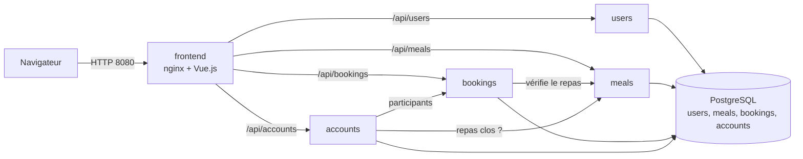

# LaTablee

LaTablee organise les repas partagés d'une colocation : planning des repas, inscriptions des colocataires et partage des frais. Projet du TP Déploiement d'Applications Microservices, réalisé en binôme par Gauthier Le Brun et Mathéo Judenne.

## 1. Description et architecture

L'application se compose de quatre microservices Python (FastAPI), d'un frontend Vue.js servi par nginx et d'une instance PostgreSQL qui héberge une base par service.



| Composant | Rôle | Port |
| --- | --- | --- |
| frontend | Interface Vue.js et reverse proxy nginx pour `/api` | 8080 |
| users | Comptes, colocations, émission des jetons JWT | 8000 |
| meals | Planning des repas | 8000 |
| bookings | Réservations et parts | 8000 |
| accounts | Dépenses, répartition, soldes, remboursements | 8000 |
| postgres | Quatre bases logiques, un rôle par base | 5432 |

Le détail des fonctionnalités, de l'API, du modèle de données et des règles de calcul est dans `ressources/Cahier des charges.md`. La documentation Swagger de chaque service est servie sur `/api/<service>/docs`, par exemple `http://localhost:8080/api/accounts/docs`.

Quelques points de conception :

- Le frontend est le seul point d'entrée. Les services n'exposent aucun port hors du réseau interne.
- Un jeton JWT (HS256) émis par `users` identifie l'utilisateur et sa colocation. Les autres services vérifient la signature avec la même clé `JWT_SECRET`.
- Les appels entre services ont un délai maximal de 3 secondes et renvoient une erreur 503 si le service appelé est indisponible.
- Les montants sont stockés en centimes. La répartition des prix distribue le reste de la division un centime par part, par identifiant croissant.
- Chaque service expose `GET /health` (le processus répond) et `GET /ready` (la base répond).

## 2. Prérequis

- Docker Desktop (Docker Compose inclus)
- kubectl
- minikube ou kind, pour la partie Kubernetes
- PowerShell pour les commandes ci dessous
- Python 3.12 et Node.js 20, uniquement pour lancer les tests ou le frontend hors Docker

## 3. Lancement en développement avec Docker Compose

```powershell
Copy-Item .env.example .env
# Remplacer les valeurs factices de .env par de vraies valeurs
docker compose up --build
```

L'application est disponible sur http://localhost:8080. Seul le frontend publie un port.

Le script `db/init.sh` crée les quatre bases et les quatre rôles uniquement à la première initialisation du volume. Après un changement de mot de passe dans `.env`, il faut recréer le volume :

```powershell
docker compose down -v
docker compose up --build
```

Tests et lint, sans Docker :

```powershell
python -m venv .venv
.\.venv\Scripts\pip install -r services/accounts/requirements-dev.txt bcrypt==4.2.1
.\.venv\Scripts\ruff check .
cd services/accounts; ..\..\.venv\Scripts\python -m pytest
```

## 4. Déploiement sur Kubernetes

Les manifestes sont dans `deploy/`, regroupés par composant et assemblés par `kustomization.yaml`, dans le namespace `latablee`.

```powershell
minikube start --driver=docker
kubectl apply -f deploy/namespace.yaml
./deploy/create_secrets.ps1
kubectl apply -k deploy/
kubectl get pods -n latablee
minikube service frontend -n latablee --url
```

Le Secret `app.secrets` n'est jamais versionné. Le script `create_secrets.ps1` le crée à partir du fichier `.env` ignoré par Git. Le dépôt ne contient que `deploy/secret.example.yaml`, avec des valeurs factices.

Les images sont `ghcr.io/matheorie/latablee/<service>:<tag>`. Les paquets GHCR du projet doivent être publics pour que le cluster les récupère sans `imagePullSecret`. Pour tester des images construites localement avec minikube :

```powershell
docker compose build
foreach ($s in "users","meals","bookings","accounts","frontend") {
  docker tag "latablee-${s}:latest" "ghcr.io/matheorie/latablee/${s}:latest"
  minikube image load "ghcr.io/matheorie/latablee/${s}:latest"
}
```

Objets créés : ConfigMap `app.config` et `postgres.init`, Secret `app.secrets`, PersistentVolume et PersistentVolumeClaim `pgdata` (1 Gi), un Deployment et un Service par composant (6 Deployments). PostgreSQL est en stratégie `Recreate` avec une réplique. Les cinq autres Deployments ont 2 répliques en `RollingUpdate` avec `maxUnavailable: 0` et `maxSurge: 1`, des sondes `readinessProbe` et `livenessProbe`, un `preStop` de 5 secondes et des limites de ressources.

## 5. Pipeline CI/CD

| Événement | Fichier | Étapes |
| --- | --- | --- |
| Push sur develop, pull request vers develop ou main | `.github/workflows/ci.yml` | Lint ruff, tests pytest par service, build des 5 images sans push |
| Tag `v*` créé sur main | `.github/workflows/cd.yml` | Vérification du tag, build et push vers GHCR, déploiement Kubernetes |

Le job `verify` du workflow CD refuse un tag qui ne pointe pas sur un commit de main. Le job `publish` pousse les tags `vX.Y.Z` et `latest`. Le job `deploy` met à jour les tags dans `kustomization.yaml`, crée le Secret à partir des secrets GitHub, applique les manifestes, attend chaque `rollout status`, teste `/health` de chaque service et exécute `kubectl rollout undo` en cas d'échec.

**Accès au cluster.** Un runner hébergé par GitHub ne peut pas joindre un minikube local. Le workflow crée donc un cluster kind éphémère avec `helm/kind-action`, ce qui démontre le déploiement complet. L'alternative est un runner self hosted sur la machine qui héberge le cluster : remplacer `runs-on` du job `deploy` et supprimer l'étape `helm/kind-action`.

**Secrets GitHub à définir** (Settings, Secrets and variables, Actions) : `POSTGRES_PASSWORD`, `USERS_DB_PASSWORD`, `MEALS_DB_PASSWORD`, `BOOKINGS_DB_PASSWORD`, `ACCOUNTS_DB_PASSWORD`, `JWT_SECRET`.

Cycle de livraison : pull request de develop vers main une fois la CI verte, puis

```powershell
git tag v1.0.0
git push origin v1.0.0
```

## 6. Démonstrations d'orchestration

Mise à l'échelle :

```powershell
kubectl scale deployment bookings --replicas=4 -n latablee
kubectl get pods -n latablee -l app=bookings
```

Mise à jour sans interruption. La boucle de test tourne dans le cluster : un `kubectl port-forward` reste collé à un seul pod et fausserait la mesure. Elle envoie 500 requêtes vers le frontend (qui les redirige vers `bookings`) et compte les échecs.

```powershell
$script = 'i=0; ok=0; ko=0; while [ $i -lt 500 ]; do c=$(curl -s -o /dev/null -w %{http_code} --max-time 3 http://frontend:8080/api/bookings/health); if [ $c = 200 ]; then ok=$((ok+1)); else ko=$((ko+1)); echo ECHEC $c; fi; i=$((i+1)); sleep 0.1; done; echo ok=$ok ko=$ko'
kubectl run loadtest -n latablee --image=curlimages/curl:8.11.1 --restart=Never -- sh -c $script
```

Pendant que la boucle tourne, dans un second terminal :

```powershell
kubectl set image deployment/bookings bookings=ghcr.io/matheorie/latablee/bookings:<nouveau tag> -n latablee
kubectl rollout status deployment/bookings -n latablee
kubectl logs loadtest -n latablee
kubectl delete pod loadtest -n latablee
```

Résultat mesuré le 2 novembre 2026 sur minikube : 500 requêtes sur 500 réussies pendant la mise à jour, puis 400 sur 400 pendant le retour arrière et 300 sur 300 pendant la suppression d'un pod. Avant l'ajout du `preStop`, la même mise à jour avait produit 3 échecs sur 500.

Retour arrière :

```powershell
kubectl rollout undo deployment/bookings -n latablee
```

Auto réparation :

```powershell
kubectl delete pod <pod> -n latablee
kubectl get pods -n latablee -w
```

Persistance : créer un repas et une dépense dans l'application, puis supprimer le pod postgres.

```powershell
kubectl delete pod -l app=postgres -n latablee
kubectl get pods -n latablee -w
```

Les données sont toujours présentes une fois le pod recréé.

## 7. Structure du dépôt et stratégie de branches

```
LaTablee/
  services/
    users/ meals/ bookings/ accounts/   app/, tests/, Dockerfile, .dockerignore, requirements.txt
  frontend/                             src/, Dockerfile, nginx.conf, .dockerignore
  db/                                   init.sh
  deploy/                               manifestes Kubernetes et kustomization.yaml
  docs/                                 architecture.md, usage_ia.md
  .github/workflows/                    ci.yml, cd.yml
  docker-compose.yml
  .env.example
  .gitignore
  README.md
```

| Branche | Rôle | Règle |
| --- | --- | --- |
| main | Production | Protégée : pull request obligatoire, CI verte obligatoire, push direct interdit |
| develop | Intégration | Reçoit les branches de fonctionnalité par pull request |
| feature/<sujet> | Une fonctionnalité | Créée depuis develop, supprimée après fusion |

Les messages de commit suivent Conventional Commits : `feat:`, `fix:`, `ci:`, `docs:`, `chore:`, `test:`.

## 8. Choix techniques et difficultés

Choix techniques :

- FastAPI et SQLAlchemy : validation des données et documentation Swagger générées, utiles pour la démonstration.
- Dockerfiles multi stage : les dépendances s'installent dans un environnement virtuel de l'étape `builder`, l'image finale ne contient que cet environnement et le code, et s'exécute avec l'utilisateur 10001. Versions de base précises, `requirements.txt` copié avant le code pour le cache de build, aucun secret dans les images.
- Une seule instance PostgreSQL avec un rôle par base : un service ne peut lire que sa propre base, ce qui économise les ressources d'un cluster local. En production réelle, on utiliserait une instance par service ou un service managé.
- Kustomize : un seul `kubectl apply -k deploy/` et un remplacement centralisé des tags d'images.
- Les noms DNS des services sont identiques dans Docker Compose et Kubernetes, donc la même configuration nginx fonctionne dans les deux.

Difficultés rencontrées et solutions :

- Ordre de démarrage : en Kubernetes, rien ne garantit que PostgreSQL soit prêt avant les services. Chaque service crée ses tables dans un thread de démarrage qui réessaie tant que la base ne répond pas, et la sonde `/ready` reste en échec jusque là.
- Création concurrente des tables par deux répliques : la tentative échoue puis réussit au passage suivant de la boucle.
- Gestion des secrets : le Secret est créé hors Git par `create_secrets.ps1` ou par la CI, et lu par les pods avec `secretKeyRef`.
- Appels entre services : le jeton de l'appelant est transmis dans l'en tête `Authorization`, avec un délai de 3 secondes et une erreur 503 explicite.
- Échecs pendant une mise à jour : à l'arrêt d'un pod, uvicorn cesse d'accepter les connexions immédiatement alors que le Service l'a encore dans ses points d'accès pendant quelques secondes. La boucle de test a compté 3 échecs sur 500 (deux connexions coupées et une erreur 502). Un `preStop` de 5 secondes laisse à Kubernetes le temps de retirer le pod du Service avant l'arrêt, et les échecs ont disparu.
- Données invalides : FastAPI renvoie 422 par défaut, un gestionnaire d'erreurs le convertit en 400 comme demandé par la spécification.

Taille des images avec et sans multi stage, mesurée avec `docker images` (2 novembre 2026) :

| Image | Sans multi stage | Avec multi stage |
| --- | --- | --- |
| users (Python) | 254 Mo | 271 Mo |
| frontend (Vue.js) | 269 Mo | 74,1 Mo |

Pour le frontend, le multi stage divise la taille par 3,6 : l'image finale ne contient que nginx et le dossier `dist`, sans Node ni `node_modules`. Pour les services Python, il n'y a pas de gain de taille : les dépendances sont des paquets binaires déjà compilés (`psycopg2-binary`, `bcrypt`), donc aucun compilateur n'est installé dans l'étape de build, et l'environnement virtuel copié ajoute environ 17 Mo. Le multi stage reste utile pour séparer l'installation des dépendances du code et du cache de build. La variante sans multi stage utilisée pour la mesure installe les dépendances directement dans l'image finale.

Évolutions possibles : autoscaling, Ingress, supervision avec Prometheus et Grafana, base de données managée.
